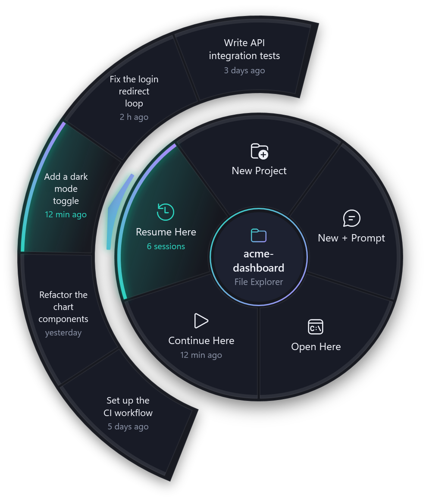
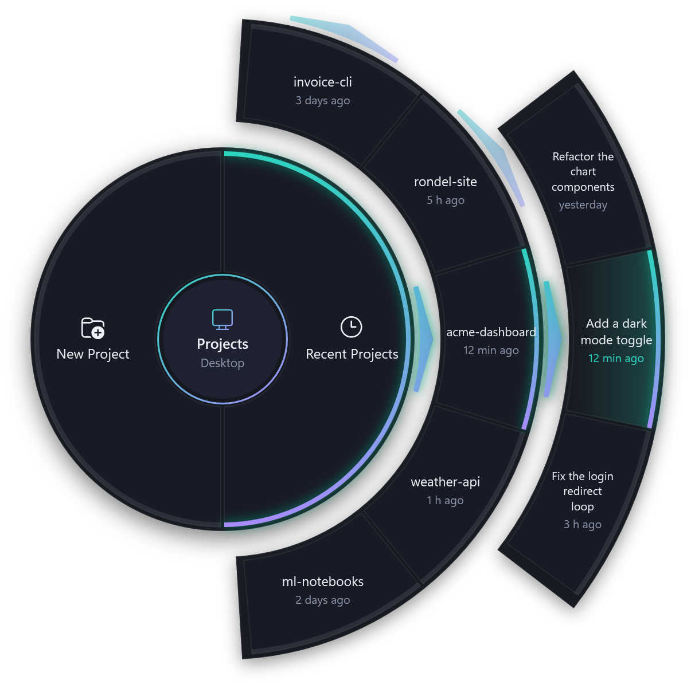
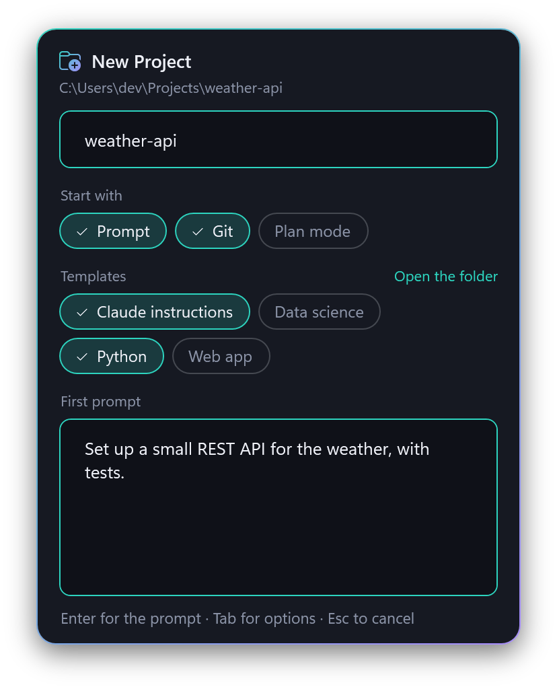
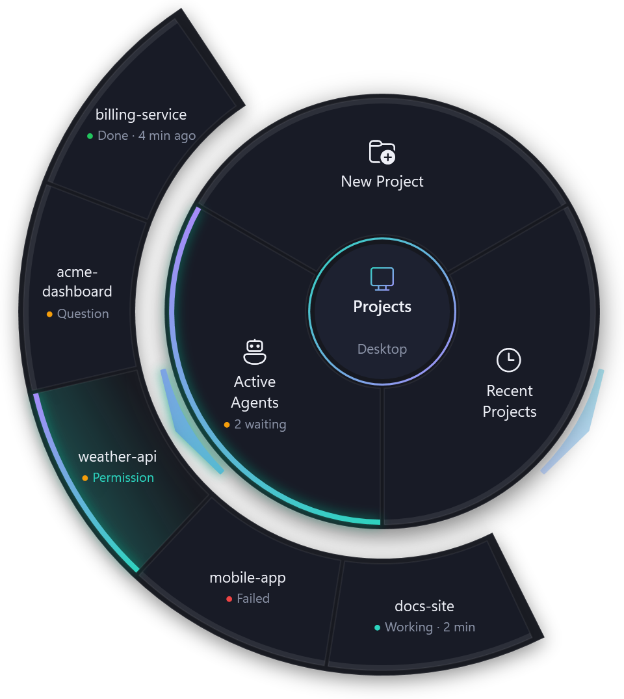
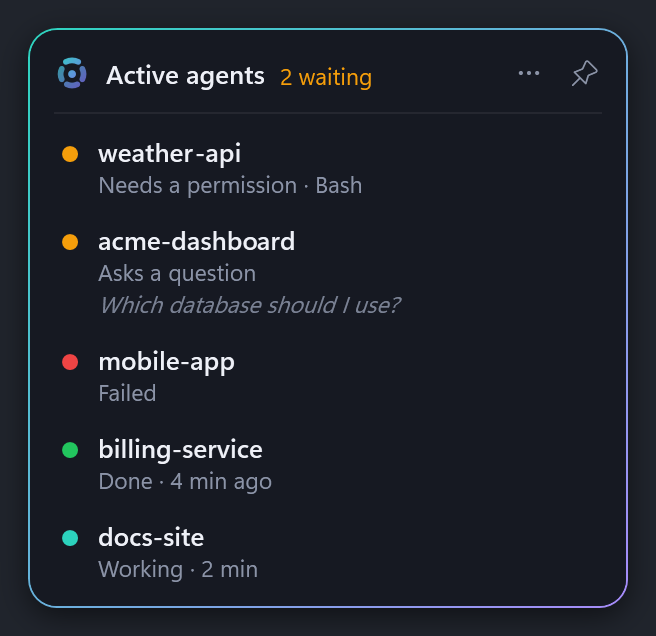
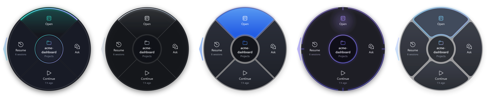

# Rondel

**A radial launcher for AI coding agents · works with Claude Code**

English · [Türkçe](README.tr.md)

<p align="center">
  
</p>

Hold **Ctrl + the left mouse button** for a moment on the Windows desktop or in File Explorer (**⌥ Option + the left mouse button** on the Mac desktop or in Finder), and a radial menu opens under the cursor. Pick a slice and your coding agent starts in a terminal, already in the right folder.

Rondel runs on Windows and macOS. **[Features by platform](docs/features.md)** shows what each one has, and since which version; **[CHANGELOG.md](CHANGELOG.md)** lists what changed in each version.

## Install

### Windows

1. Install [Claude Code](https://docs.anthropic.com/en/docs/claude-code) and check that `claude` runs in a terminal.
2. Download `Rondel-<version>-win-x64.exe` (or `-win-arm64.exe` for ARM PCs) from the [latest release](https://github.com/xelfiera-shn/rondel/releases/latest), put it anywhere and run it. The Rondel icon appears in the notification area.
   - The executable is not code-signed yet, so SmartScreen may warn on first start: **More info → Run anyway**. Each release lists SHA-256 checksums and carries a build provenance attestation.
3. Right-click the icon and tick **Start with Windows**.

There is no installer and Rondel needs no admin rights. Windows 10 and 11 are supported. From 0.7.0 on, Rondel keeps itself up to date (see [Updates](#updates)).

### macOS

1. Install [Claude Code](https://docs.anthropic.com/en/docs/claude-code) and check that `claude` runs in Terminal.
2. Download `Rondel-<version>-osx-arm64.zip` (Apple Silicon) or `-osx-x64.zip` (Intel) from the [latest release](https://github.com/xelfiera-shn/rondel/releases/latest), unzip it and move **Rondel** into **Applications**.
3. Open it. Rondel is signed, but not notarized by Apple, so macOS blocks the first start: open **System Settings → Privacy & Security**, scroll down to the message about Rondel and click **Open Anyway**. macOS asks this once more after every update you download.
4. Allow **Accessibility** when asked: Rondel needs it to notice ⌥ + hold. Allow **Finder** too: Rondel asks Finder which folder a window shows. Both stay granted across updates. The Rondel icon appears in the menu bar; its menu offers the permissions that are still missing.
5. Menu bar icon → **Settings…** → tick **Open at login**.

Rondel runs on macOS 15 and later and has no Dock icon. Opening it again while it runs opens its settings.

## Use

| Where you hold | Actions | Folder |
|---|---|---|
| Empty desktop | New Project, Recent Projects, Active Agents | Your projects folder (default `%USERPROFILE%\Projects`), or the project you pick |
| Empty area of a folder in File Explorer | New Project, Open Here, Ask Here, Continue Here, Resume Here | The folder that is open |
| A folder (on the desktop or in File Explorer) | Open, Ask, Continue, Resume | That folder |
| A file (on the desktop or in File Explorer) | Ask About This File, Open Here, Continue Here, Resume Here | The folder the file is in |

On macOS it is the same with ⌥ Option instead of Ctrl, Finder instead of File Explorer and `~/Projects` as the default projects folder; the desktop menu has no Active Agents yet.

- **Open** starts a new session, **Continue** the most recent one, **Resume** lets you pick (`claude`, `claude --continue`, `claude --resume`).
- **Ask** and **Ask Here** ask only for a prompt and start a new session with it. **Ask About This File** does the same in the file's folder and puts the file first in the prompt (`@Program.cs`, or `@"My Notes.md"` for a name with spaces), so Claude Code reads it right away.
- **Resume opens outward** when the folder has two or more sessions: the five newest appear on an arc around it, the newest right outside the slice. Pick one to resume it directly.
- **Recent Projects** (desktop menu) opens into the five folders you worked in most recently. Pick one to resume its latest session; a project with two or more sessions opens further into them, the same way.

<p align="center">
  
</p>

- Continue and Resume show when the last session was and how many there are, and are dimmed when there are none.
- **New Project** opens a card: the folder name, how the project starts, and the templates copied into it. Start options can be combined:
  - **Prompt** — start the agent with a first prompt;
  - **Git** — run `git init` before the agent starts;
  - **Plan mode** — start the agent in plan mode;
  - **Templates** — every folder in `%APPDATA%\Rondel\Templates` (`~/Library/Application Support/Rondel/Templates` on macOS) is a template (**Open the folder** on the card). Pick several, for example a language's files and your field's agent instructions; when two have the same file, the one further right wins.

  The card remembers your last choice, so the usual project is a name and **Enter**. **Tab** moves through the options and **Space** turns one on or off; with Prompt on, **Enter** goes on to the prompt and **Ctrl+Enter** (**⌘↩** on macOS) creates. Options you never use can be turned off in Settings.

<p align="center">
  
</p>

- The Ask slices go straight to the prompt (**Ctrl+Enter** or **⌘↩** starts, **Esc** cancels).
- Click a slice, press **1–N**, or use the arrow keys and **Enter**; **Tab** steps into the items of the selected slice or project (newest first), **Esc** steps back out and finally closes. You can also keep holding, move onto a slice and release.
- Ordinary Ctrl+click and Ctrl+drag keep working everywhere (⌥+click and ⌥+drag on macOS). The navigation pane, the address bar, virtual locations such as This PC, and File Explorer windows running as administrator don't open the menu.
- An optional keyboard shortcut (Settings) opens the menu at the mouse cursor. Windows only for now.

## Active agents

Rondel follows the agents it starts, so you don't have to keep an eye on their terminals. Windows only for now.

- **Notifications.** When an agent asks for a permission or asks you a question, finishes its turn, or stops with an error, a notification names the project and says what it needs. Click it to bring the agent's terminal to the front. No notification appears while you are in that terminal.
- **Active Agents** (desktop menu) opens into the agents you started from Rondel, those waiting for you first. A dot shows what each is doing: amber, waiting for a permission or an answer; green, done; red, stopped with an error; the theme's accent, working. Pick one to bring its terminal to the front. The slice itself says how many are waiting.
- An optional shortcut (Settings → **Active agents**) opens this arc at the mouse cursor, wherever you are.
- The **agents card** (optional, Settings → **Active agents**) keeps the running agents in sight, with the same dots. It appears when the first agent starts and hides when none is left. Collapsed, it is Rondel's mark with the number of agents that need you, red as soon as one stopped with an error; it opens while the mouse is over it. Drag it anywhere: the pin keeps it open, and its **⋯** menu puts it above other windows or on the desktop. Over full-screen apps it hides, unless you keep it there; then it stays open and lets clicks through. Its own shortcut shows or hides it, and notifications can stay quiet while it is shown.

<p align="center">
  
  
</p>

Rondel starts Claude Code with an extra settings file (`--settings`) whose hooks report each event to Rondel, on your computer only (127.0.0.1); your own Claude Code settings are not changed. Each agent opens in a Windows Terminal window of its own, so that window can be brought to the front. If you quit Rondel while an agent is still running, Claude Code shows a hook error under each prompt until Rondel runs again, and Rondel then picks the agent up. To start agents as before, turn off **Follow the agents Rondel starts** in Settings.

## Updates

Once a day, and when the connection comes back, Rondel asks GitHub for its latest release. When a newer one is out, a notification says so. Click it, or tray icon → **Update to …**, to see what is new and choose **Update now**, **Later** or **Skip this version**.

Updating downloads the new executable, checks it, puts it in place of the running one and restarts Rondel; your agents keep running. Rondel takes the file only when the release's checksums carry the signature of Rondel's release key, which only the release workflow holds, and the file matches its checksum; anything else is deleted. If Rondel's folder is not writable (for example under Program Files), it opens the release page instead.

Settings → **Check for updates automatically** turns the daily check off; **Check now** works either way. Versions before 0.7.0 cannot update themselves: download 0.7.0 once by hand. The macOS app does not update itself yet: download the new zip from the release page and replace Rondel in Applications. From 0.8.0 on, the Windows app does not announce a release that changes only the macOS app (**Check now** still shows it).

## Settings and customization

Tray icon → **Settings…**: language (Automatic / English / Türkçe), the menu's look, projects folder, hold duration, keyboard shortcut, the agent's command (`claude`, or an alias such as `cc`), terminal (Windows Terminal or console window), shell (PowerShell 7 or Windows PowerShell), following agents with their notifications, shortcut and card, update checks, the options on the New Project card and the templates folder.

On macOS, menu bar icon → **Settings…** has the same, except the keyboard shortcut and active agents, with Terminal or iTerm2 as the terminal; the agent runs in your login shell, so `PATH` and aliases from `~/.zprofile` and `~/.zshrc` work. Its **Permissions** section shows whether Accessibility and Finder are allowed, and **Open at login** adds Rondel to your login items.

**Appearance**: five themes — Rondel, Line, Spotlight, Orbit and Petal — each in dark and light, chosen from pictures of the menu; dark or light can follow Windows (or macOS) or stay fixed, and the accent color is the theme's own, a ready-made pair or your own `#RRGGBB` colors. Changes show in the menu at once.

<p align="center">
  
</p>

Menus, actions and agents live in `%APPDATA%\Rondel\settings.json` (`~/Library/Application Support/Rondel/settings.json` on macOS) and apply as soon as the file is saved. For example, to add a slice that opens Claude Code in plan mode, add an action and put its id into a menu:

```jsonc
"Actions": [
  // ... the existing actions ...
  { "Id": "plan", "Label": "Plan", "Icon": "E8FD", "Capability": "Plan" }
],
"Menus": {
  "FolderItem": ["open", "ask", "continue", "resume", "plan"]
}
```

`Label` can be plain text; labels starting with `@` are built-in translations. `Icon` is a [Segoe Fluent Icons](https://learn.microsoft.com/windows/apps/design/style/segoe-fluent-icons-font) code point. Agents are profiles with a command and arguments per capability (`Open`, `Continue`, `Resume`, `ResumeById`, `Prompt`, `Plan`), so another coding agent can be added the same way — see [docs/architecture.md](docs/architecture.md#agent-profiles).

## Troubleshooting

- Turn on **Debug logging** in Settings, reproduce the problem, then tray icon → **Open log folder** (`%LOCALAPPDATA%\Rondel\logs`). Every trigger logs the UI Automation chain, the detected context and the folder.
- `Rondel.exe --probe X Y result.txt` classifies a single screen point (physical pixels) with the full trace.
- If the terminal says the command was not found, check the command in Settings and your `PATH`; aliases from your PowerShell profile work too.
- On macOS the logs are in `~/Library/Logs/Rondel`, and the probe runs through `open -n -W /Applications/Rondel.app --args --probe X Y ~/result.txt` (points), so that Rondel's own permissions apply. Settings shows whether the command is found in your login shell. If ⌥ + hold does nothing, check **Permissions** in Settings.

Please include the log lines or the probe output when you [report a bug](https://github.com/xelfiera-shn/rondel/issues/new/choose).

## Privacy

Rondel has no telemetry. It reads the agent's local session data only to show the hints and the recent sessions, and it receives the events of the agents it starts on 127.0.0.1 only. Once a day the Windows app asks GitHub for its latest release (this can be turned off in Settings); the request carries nothing but Rondel's version. It writes nothing except its own settings (with the hooks file for the agents it starts), its logs, the list of its agents' windows, the update checks' state and downloads and, if you enable it, the start-with-Windows entry (the login item on macOS).

## Build from source

Requires the .NET 10 SDK; Windows for `Rondel.exe`, macOS for `Rondel.app`.

```powershell
dotnet build
dotnet test
.\build\publish.ps1       # dist\win-x64\Rondel.exe, self-contained single file
build/publish-macos.sh    # dist/osx-arm64/Rondel.app (on macOS), see CONTRIBUTING.md for its certificate
```

See [CONTRIBUTING.md](CONTRIBUTING.md) for branches, commit messages and releases, and [docs/](docs/) for the design notes and the [roadmap](docs/roadmap.md).

## License

[MIT](LICENSE) © Ahmet Şahin

---

Rondel is an independent project. It is not affiliated with, endorsed by or sponsored by Anthropic. Claude and Claude Code are trademarks of Anthropic, PBC.
