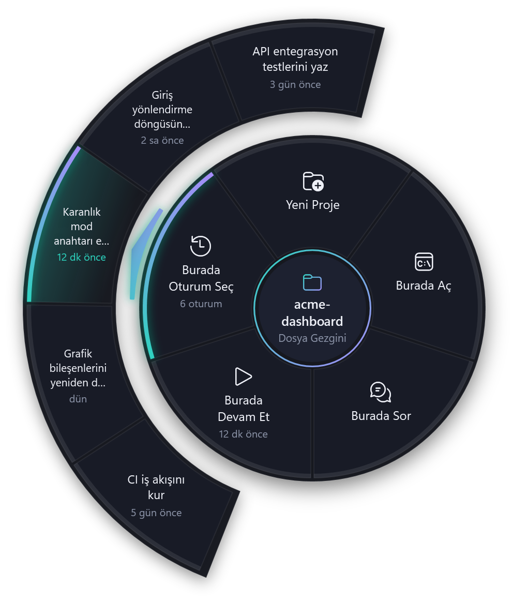
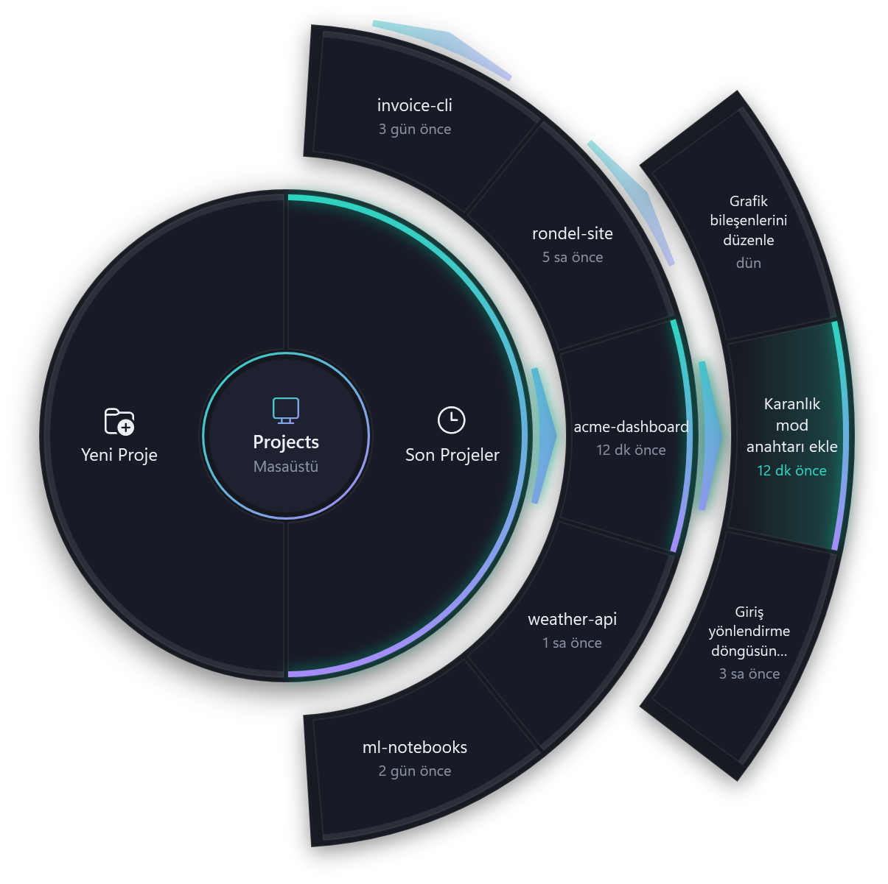
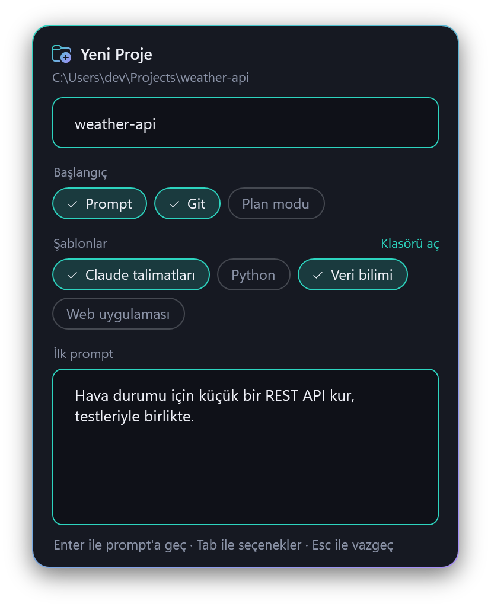
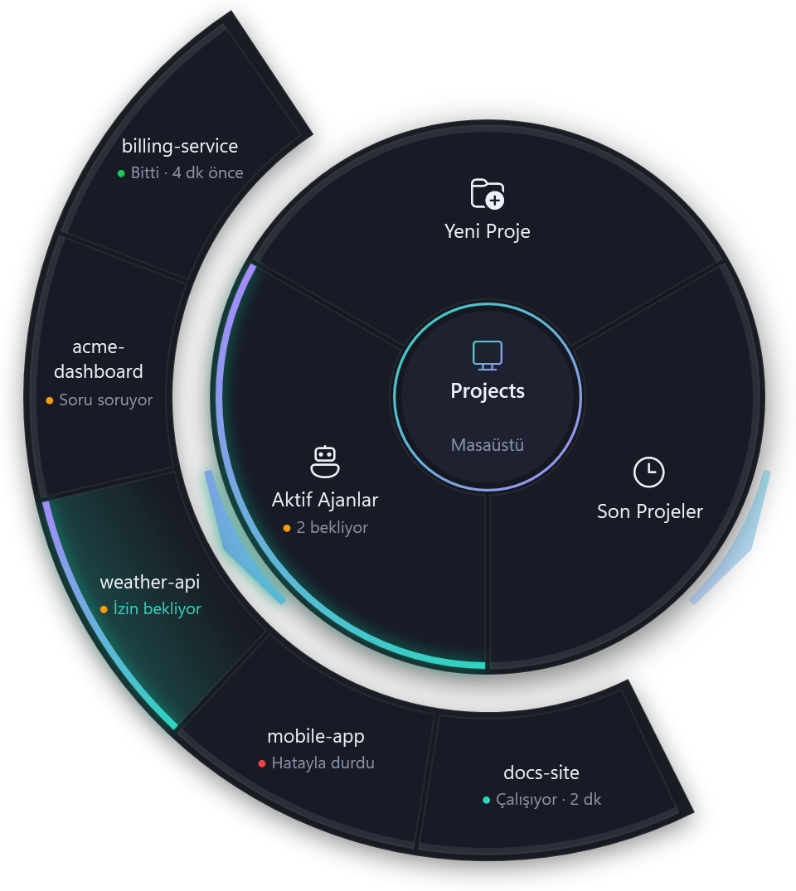
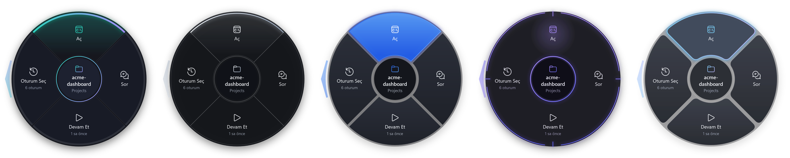

# Rondel

**Yapay zekâ kodlama ajanları için dairesel başlatıcı · Claude Code ile çalışır**

[English](README.md) · Türkçe

<p align="center">
  
</p>

Windows masaüstünde veya Dosya Gezgini'nde **Ctrl + sol fare tuşunu** kısa bir süre basılı tutun: imlecin altında dairesel bir menü açılır. Bir dilim seçtiğinizde kodlama ajanınız, doğru klasörde açılmış bir terminalde başlar.

## Kurulum

1. [Claude Code](https://docs.anthropic.com/en/docs/claude-code)'u kurun ve terminalde `claude` komutunun çalıştığını görün.
2. [Son sürümden](https://github.com/xelfiera-shn/rondel/releases/latest) `Rondel-<sürüm>-win-x64.exe` dosyasını (ARM bilgisayarlar için `-win-arm64.exe`) indirin, istediğiniz bir klasöre koyup çalıştırın. Bildirim alanında Rondel ikonu belirir.
   - Dosya henüz kod imzalı olmadığı için ilk açılışta SmartScreen uyarısı çıkabilir: **Ek bilgi → Yine de çalıştır**. Her sürümde SHA-256 özetleri ve derleme kaynağı doğrulaması (build provenance) bulunur.
3. İkona sağ tıklayıp **Windows ile başlat**'ı işaretleyin.

Kurulum programı yoktur, yönetici izni gerekmez. Windows 10 ve 11 desteklenir. Rondel 0.7.0'dan itibaren kendini güncel tutar (bkz. [Güncellemeler](#güncellemeler)).

## Kullanım

| Nerede basılı tutarsınız | Aksiyonlar | Klasör |
|---|---|---|
| Masaüstünde boş alan | Yeni Proje, Son Projeler, Aktif Ajanlar | Proje klasörünüz (varsayılan `%USERPROFILE%\Projects`) ya da seçtiğiniz proje |
| Dosya Gezgini'nde bir klasörün boş alanı | Yeni Proje, Burada Aç, Burada Sor, Burada Devam Et, Burada Oturum Seç | Açık olan klasör |
| Bir klasörün üzerinde (masaüstü veya Dosya Gezgini) | Aç, Sor, Devam Et, Oturum Seç | O klasör |
| Bir dosyanın üzerinde (masaüstü veya Dosya Gezgini) | Bu Dosyayı Sor, Burada Aç, Burada Devam Et, Burada Oturum Seç | Dosyanın bulunduğu klasör |

- **Aç** yeni bir oturum başlatır, **Devam Et** en son oturumu sürdürür, **Oturum Seç** listeden seçtirir (`claude`, `claude --continue`, `claude --resume`).
- **Sor** ve **Burada Sor** yalnızca bir prompt sorar ve yeni oturumu onunla başlatır. **Bu Dosyayı Sor** aynısını dosyanın klasöründe yapar ve dosyayı prompt'un başına ekler (`@Program.cs`, boşluklu adlarda `@"Proje Notları.md"`); Claude Code dosyayı hemen okur.
- **Oturum Seç dışa doğru açılır** (klasörde iki veya daha fazla oturum varsa): son beş oturum dilimin etrafındaki bir yayda belirir, en yenisi tam dilimin dışında. Birini seçerek o oturumu doğrudan açabilirsiniz.
- **Son Projeler** (masaüstü menüsü) en son çalıştığınız beş klasöre açılır. Birini seçince o projenin son oturumu açılır; iki veya daha fazla oturumu olan bir proje de aynı şekilde oturumlarına açılır.

<p align="center">
  
</p>

- Devam Et ve Oturum Seç, son oturumun ne zaman olduğunu ve kaç oturum bulunduğunu gösterir; oturum yoksa soluk görünürler.
- **Yeni Proje** bir kart açar: klasör adı, projenin nasıl başlayacağı ve içine kopyalanacak şablonlar. Başlangıç seçenekleri birleştirilebilir:
  - **Prompt** — ajanı ilk prompt'la başlatır;
  - **Git** — ajan başlamadan `git init` çalıştırır;
  - **Plan modu** — ajanı plan modunda başlatır;
  - **Şablonlar** — `%APPDATA%\Rondel\Templates` içindeki her klasör bir şablondur (kartta **Klasörü aç**). Birden fazlasını seçebilirsiniz; örneğin bir dilin dosyaları ve alanınıza uygun ajan talimatları. İki şablonda aynı dosya varsa sağdaki kazanır.

  Kart son seçiminizi hatırlar; her zamanki proje için ad yazıp **Enter**'a basmak yeter. **Tab** seçenekler arasında gezer, **Boşluk** seçeneği açıp kapatır; Prompt açıkken **Enter** prompt'a geçer, **Ctrl+Enter** oluşturur. Hiç kullanmadığınız seçenekleri Ayarlar'dan kapatabilirsiniz.

<p align="center">
  
</p>

- Sor dilimleri doğrudan prompt'a geçer (**Ctrl+Enter** başlatır, **Esc** vazgeçer).
- Dilime tıklayın, **1–N** tuşlarına basın ya da ok tuşları ve **Enter** kullanın; **Tab** seçili dilimin ya da projenin öğelerine (en yeniden başlayarak) geçer, **Esc** bir seviye geri çıkar ve en sonunda menüyü kapatır. Basılı tutmaya devam edip bir dilimin üzerine gelerek bırakmak da seçer.
- Normal Ctrl+tık ve Ctrl+sürükle her yerde eskisi gibi çalışır. Gezinti bölmesi, adres çubuğu, Bu Bilgisayar gibi sanal konumlar ve yönetici olarak çalışan Dosya Gezgini pencereleri menüyü açmaz.
- İsteğe bağlı bir klavye kısayolu (Ayarlar) menüyü fare imlecinin olduğu yerde açar.

## Aktif ajanlar

Rondel başlattığı ajanları takip eder; terminallerine göz kulak olmanız gerekmez.

- **Bildirimler.** Bir ajan izin istediğinde ya da size bir soru sorduğunda, işini bitirdiğinde veya bir hatayla durduğunda gelen bildirim projenin adını ve ne gerektiğini söyler. Bildirime tıklayınca ajanın terminali öne gelir. O terminaldeyken bildirim gösterilmez.
- **Aktif Ajanlar** (masaüstü menüsü) Rondel'den başlattığınız ajanlara açılır; sizi bekleyenler önce gelir. Her birinin yanındaki nokta ne yaptığını gösterir: sarı, izin ya da cevap bekliyor; yeşil, bitti; kırmızı, bir hatayla durdu; temanın vurgu rengi, çalışıyor. Birini seçince terminali öne gelir. Dilimin kendisi kaç ajanın beklediğini söyler.
- İsteğe bağlı bir kısayol (Ayarlar → **Aktif ajanlar**) bu yayı, nerede olursanız olun fare imlecinin olduğu yerde açar.

<p align="center">
  
</p>

Rondel Claude Code'u ek bir ayar dosyasıyla (`--settings`) başlatır; bu dosyadaki hook'lar her olayı yalnızca bilgisayarınızın içinde (127.0.0.1) Rondel'e bildirir. Kendi Claude Code ayarlarınız değişmez. Her ajan kendi Windows Terminal penceresinde açılır, böylece o pencere öne getirilebilir. Bir ajan çalışırken Rondel'i kapatırsanız Claude Code, Rondel yeniden açılana kadar her prompt'un altında bir hook hatası gösterir; Rondel açılınca ajanı kaldığı yerden takip eder. Ajanları eskisi gibi başlatmak için Ayarlar'da **Rondel'in başlattığı ajanları takip et** seçeneğini kapatın.

## Güncellemeler

Rondel günde bir kez ve internet bağlantısı geldiğinde GitHub'a son sürümünü sorar. Daha yeni bir sürüm çıkmışsa bir bildirim bunu söyler. Bildirime ya da tepsi ikonu → **… sürümüne güncelle** satırına tıklayınca yenilikleri görür; **Şimdi güncelle**, **Sonra** veya **Bu sürümü atla** seçeneklerinden birini seçersiniz.

Güncelleme yeni exe'yi indirir, doğrular, çalışan exe'nin yerine koyar ve Rondel'i yeniden başlatır; ajanlarınız çalışmaya devam eder. Rondel dosyayı yalnızca yayının özet dosyası, yalnızca yayın iş akışında bulunan Rondel yayın anahtarıyla imzalıysa ve dosya bu özetle eşleşiyorsa kullanır; eşleşmeyen dosya silinir. Rondel'in klasörüne yazılamıyorsa (örneğin Program Files altında) bunun yerine sürüm sayfası açılır.

Ayarlar'daki **Güncellemeleri otomatik denetle** seçeneği günlük denetimi kapatır; **Şimdi denetle** her durumda çalışır. 0.7.0'dan önceki sürümler kendini güncelleyemez: 0.7.0'ı bir kez elle indirin.

## Ayarlar ve özelleştirme

Tray ikonu → **Ayarlar…**: dil (Otomatik / English / Türkçe), menünün görünümü, proje klasörü, basılı tutma süresi, klavye kısayolu, ajanın komutu (`claude` ya da `cc` gibi bir alias), terminal (Windows Terminal veya konsol penceresi), kabuk (PowerShell 7 veya Windows PowerShell), ajanların takibi ile bildirimleri ve kısayolu, güncelleme denetimi, Yeni Proje kartındaki seçenekler ve şablon klasörü.

**Görünüm**: beş tema — Rondel, İnce Halka, Vurgu, Yörünge ve Yaprak — her biri koyu ve açık; menünün resimlerinden seçilir. Koyu ya da açık mod Windows'u izleyebilir ya da sabit kalabilir; vurgu rengi temanın kendi rengi, hazır bir çift ya da kendi `#RRGGBB` renkleriniz olabilir. Değişiklikler menüye hemen yansır.

<p align="center">
  
</p>

Menüler, aksiyonlar ve ajanlar `%APPDATA%\Rondel\settings.json` içindedir; dosya kaydedilince değişiklik hemen uygulanır. Örneğin Claude Code'u plan modunda açan bir dilim eklemek için bir aksiyon ekleyip kimliğini bir menüye yazın:

```jsonc
"Actions": [
  // ... mevcut aksiyonlar ...
  { "Id": "plan", "Label": "Plan", "Icon": "E8FD", "Capability": "Plan" }
],
"Menus": {
  "FolderItem": ["open", "ask", "continue", "resume", "plan"]
}
```

`Label` düz metin olabilir; `@` ile başlayanlar yerleşik çevirilerdir. `Icon` bir [Segoe Fluent Icons](https://learn.microsoft.com/windows/apps/design/style/segoe-fluent-icons-font) kod noktasıdır. Ajanlar, bir komut ve her yetenek (`Open`, `Continue`, `Resume`, `ResumeById`, `Prompt`, `Plan`) için argümanlardan oluşan profillerdir; başka bir kodlama ajanı da aynı şekilde eklenebilir — bkz. [docs/architecture.md](docs/architecture.md#agent-profiles).

## Sorun giderme

- Ayarlar'da **Hata ayıklama logu**'nu açın, sorunu tekrarlayın, sonra tray ikonu → **Log klasörünü aç** (`%LOCALAPPDATA%\Rondel\logs`). Her tetiklemede UI Automation zinciri, algılanan bağlam ve klasör yazılır.
- `Rondel.exe --probe X Y sonuc.txt` tek bir ekran noktasını (fiziksel piksel) tüm ayrıntılarıyla sınıflandırır.
- Terminal komutun bulunamadığını söylüyorsa Ayarlar'daki komutu ve `PATH`'i kontrol edin; PowerShell profilinizdeki alias'lar da çalışır.

[Hata bildirirken](https://github.com/xelfiera-shn/rondel/issues/new/choose) log satırlarını veya probe çıktısını eklemeniz çok yardımcı olur.

## Gizlilik

Rondel telemetri içermez. Ajanın yerel oturum verisini yalnızca ipuçlarını ve son oturumları göstermek için okur; başlattığı ajanların olaylarını yalnızca 127.0.0.1 üzerinden alır. Günde bir kez GitHub'a son sürümünü sorar (Ayarlar'dan kapatılabilir); bu istek Rondel'in sürümü dışında hiçbir bilgi taşımaz. Kendi ayarları (başlattığı ajanlar için hook dosyasıyla birlikte), logları, ajanlarının pencere listesi, güncelleme denetiminin durumu ile indirdiği güncellemeler ve (açarsanız) Windows ile başlatma kaydı dışında hiçbir şey yazmaz.

## Kaynaktan derleme

Windows ve .NET 10 SDK gerekir.

```powershell
dotnet build
dotnet test
.\build\publish.ps1     # dist\win-x64\Rondel.exe, tek dosyalık, bağımsız çalışan exe
```

Dallar, commit mesajları ve sürümler için [CONTRIBUTING.md](CONTRIBUTING.md), tasarım notları ve [yol haritası](docs/roadmap.md) için [docs/](docs/) klasörüne bakın.

## Lisans

[MIT](LICENSE) © Ahmet Şahin

---

Rondel bağımsız bir projedir; Anthropic ile bağlantılı değildir, Anthropic tarafından onaylanmamış veya desteklenmemiştir. Claude ve Claude Code, Anthropic, PBC'nin ticari markalarıdır.
